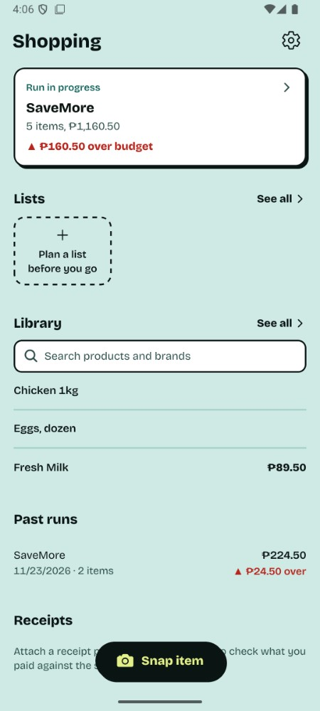
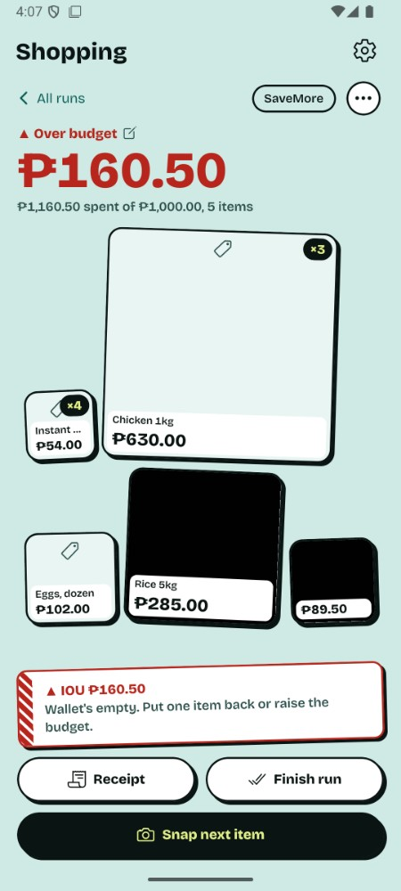
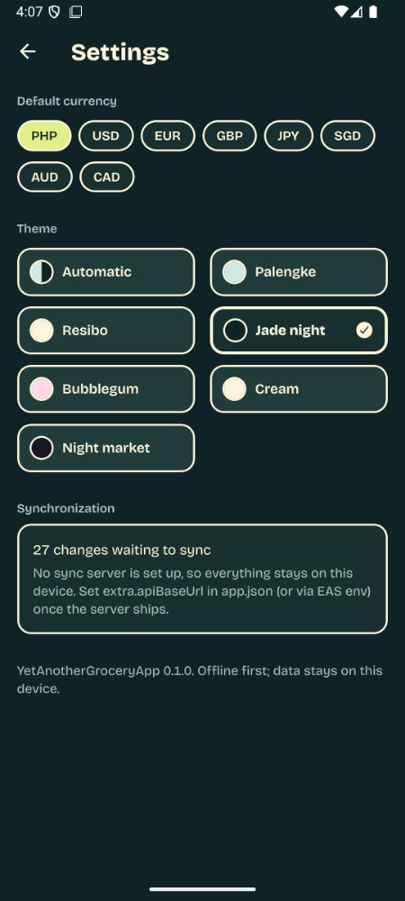
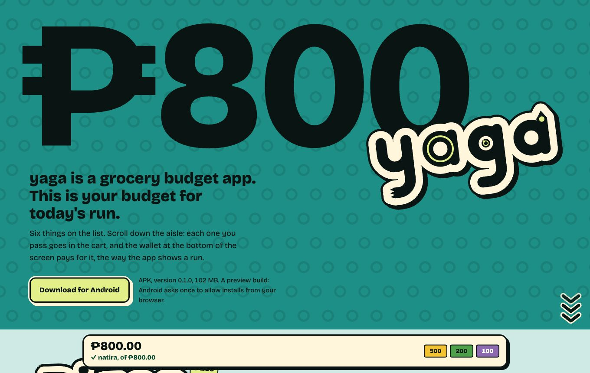

# YetAnotherGroceryApp

A personal grocery management application that helps users track purchases,
monitor price history, verify receipt accuracy, and analyze long-term grocery
spending. Built with offline-first support, cloud synchronization, and
personal analytics to help users make smarter shopping decisions.

**[Open the landing page](https://yetanothergroceryapp.gulanesgene.workers.dev/)** or
**[download the Android APK](https://yetanothergroceryapp.gulanesgene.workers.dev/download/yaga.apk)**
(version 0.1.0, 102 MB, a preview build; Android asks once to allow installs from your browser).

## Screenshots

<table>
  <tr>
    <td width="33%"></td>
    <td width="33%"></td>
    <td width="33%"></td>
  </tr>
  <tr>
    <td>Home is the hub, with one main action: Snap item.</td>
    <td>During a run, stickers are sized by price. Over budget, the wallet becomes an IOU slip.</td>
    <td>Six themes, including Jade night.</td>
  </tr>
</table>



## Repository layout

| Path | What it is | Status |
| --- | --- | --- |
| `mobile/` | Expo (SDK 57) + React Native app — the data-capture surface | **Working core**: offline SQLite + barcode scanning + trips/lists/library; verified on device via Expo Go |
| `web-desktop/` | Next.js 14 web app + Tauri 2 desktop shell — the analytics surface | **Data foundation live**: SQLite replica + SQL analytics via DataSource, dashboard wired, pull-sync + CSV exports |
| `site/`, `worker/`, `wrangler.jsonc` | Landing page with a playable cart demo, plus the APK download from Cloudflare R2, served by the `yetanothergroceryapp` Worker (deploys on merge to `main`) | Live |
| `design/logo/` | Final "yaga" logo (Jade Palengke): SVG/PNG, generator scripts, app icon/splash sources, colour research | Final |
| `api/` | Shared sync + analytics backend (Fastify + Drizzle, file/libSQL) | **Dev-ready**: sync push/pull + analytics endpoints, 20 tests; deployment + Clerk auth pending |
| `specs.md` | Functional/product specification | Stable |
| `tech.mobile.md` | Mobile technical requirements (+ implementation status) | Source of truth for mobile |
| `tech.desktop.md` | Web/desktop technical requirements | Design only |

The shared backend (delta sync + Turso) is not started; see the sync engine
section of `tech.mobile.md` for the intended protocol. The mobile app already
journals every mutation into a `sync_mutations` outbox, so the future sync
client only has to drain it.

## Quickstart (mobile)

```sh
cd mobile
npm install
npm run typecheck && npm run lint && npm test   # 227 tests, no device needed
npx expo start                                  # then scan with Expo Go
```

The mobile app has no third-party native modules, so it runs directly in
Expo Go — no dev build required. Device testing notes (firewall, tunnel
fallback) live in [`mobile/README.md`](mobile/README.md).

## Milestones

- [x] Expo SDK 57 baseline, CI (typecheck/lint/jest), EAS project linked
- [x] Offline-first database: Drizzle schema, migrations, repositories,
      outbox + tombstones (every write journaled for sync)
- [x] Capture flow: barcode scanning (expo-camera/ML Kit), manual product
      capture, price capture, duplicate-scan handling
- [x] OCR price capture (`expo-mlkit-ocr`) with tap-to-confirm overlay
- [x] Receipt v1: OCR line classification, editable confirmation, trip
      matching, shelf-vs-receipt discrepancy and overcharge rollup
- [x] Shopping trips (survive app kills), lists → trips, library, history
- [x] Device-verified via Expo Go (OCR paths need a dev/custom build)
- [x] Sticker-wallet redesign: Home hub (no tab bar), photo-sticker cart,
      budget as bills/coins/IOU, Bricolage Grotesque, six themes
- [x] Final logo (Jade Palengke), app icon, adaptive icon and splash
- [x] Sync engine client: outbox push, cursor pull, field-level LWW,
      conflict audit, backoff — tested against a mock transport; activates
      automatically once `extra.apiBaseUrl` points at a backend
- [x] Receipt alias learning (store-scoped) + background sync task
- [x] Desktop data foundation: local SQLite replica migrations, SQL
      analytics source (Tauri plugin-sql, tested on better-sqlite3), domain
      analytics module, live dashboard through the shared DataSource
- [x] Sync backend (`api/`): push/pull delta sync with server revisions,
      LWW, tombstones, idempotency + analytics endpoints matching the
      desktop client contract — dev-ready, deployment pending
- [ ] EAS builds (dev APK for OCR validation + signed preview APK) — on demand
- [ ] Deploy backend + Clerk auth; end-to-end sync across surfaces
- [ ] Background tasks, auth (Clerk), Detox E2E
